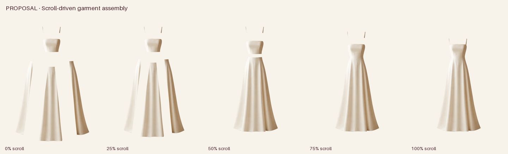

# Sue’s Tailor Shop: garment assembly review

**Status: the five-cutout proposal is REJECTED and obsolete.** The user explicitly rejected that result because it did not deliver the cinematic quality of the reference. Its screenshots, recordings, layer assets, and technical checks are historical evidence, not an accepted design or a visual quality pass.

The replacement is an original generated garment film, converted to an image sequence and drawn into a canvas as the visitor scrolls, following the verified reference mechanism. Image generation is pending; the 10-second MiniMax H3 video is planned and quoted. Neither the new visual story nor its integration has been accepted or validated. The service, review, process, fitting request, and visit sections retain their existing scope.

## Reference and evidence boundaries

Reference: https://www.instagram.com/reel/Da8LPoqoLY5/

Creator: @octaboot.lb. The official creator site https://octaboot.com/ links to that Instagram account. The actual reference website was identified from the reel’s browser address bar and verified by its title and matching chapter copy: https://tailor-by-octaboot.vercel.app/ . See [the reference study](reference-study.md) for observed frames and separately verified implementation details.

The reference study distinguishes observations from the recorded reel, facts from the public reference site, and the proposed gown translation. The source reel’s outer camera movement is a handheld recording of a laptop; it is not automatically evidence of a camera move within the website.

## Rejected five-cutout storyboard — obsolete

| Scroll | Proposed garment action | Customer purpose |
| --- | --- | --- |
| 0% | Five pieces visibly separated, same camera and coordinate system | Establish the garment as the central subject |
| 25% | Left, center, and right skirt panels meet | Make the response to scrolling unmistakable |
| 50% | Bodice settles onto the joined skirt | Maintain continuity of the same garment |
| 75% | Straps meet the neckline; all pieces align | Focus attention on fit and finishing details |
| 100% | The aligned silhouette receives a subtle final camera push | End on a calm, legible finished dress |

This storyboard and its captured browser checkpoints document the rejected attempt. They are not final choreography and must not be used as acceptance evidence for the replacement. The masks were illustrative presentation pieces, not a sewing tutorial or a claim that Sue designs or makes gowns from scratch. Wedding dress work remains a case-by-case inquiry.

## Historical cutout provenance

The rejected five transparent layers reuse the final panel of the existing Higgsfield GPT Image 2 generation. All layers use the same 640 × 1086 canvas. They remain available for provenance only and are not an approved production visual. Pixel alignment and file integrity do not establish cinematic quality.

- Cutout extraction itself used **0 additional generation credits**. That historical statement does not describe the replacement generation now pending.
- Five historical layers total 94,234 bytes; assembled fallback 73,162 bytes. The extraction script’s RGBA checks cover file integrity only.
- [Asset manifest](../../../../public/demos/best-tailor/media/assembly/manifest.json)
- [Reproduction script](../../../../scripts/sues-tailor/extract_assembly.py)
- [Full original prompt and provenance](../../../../src/demos/best-tailor/assets.md)

## Generation ledger — replacement pending

| Item | Credits | State |
| --- | --- | --- |
| Original bridal triptych | 6.5 | Completed generation; previously recorded credit use |
| New Higgsfield image, job `bed32843-333b-436c-9029-f676b29fae1b` | 2.75 | Allocated to the submitted image job; result pending and unaccepted |
| Planned 10-second MiniMax H3 video | 20 | Quoted only; submission, completion, and charge not yet confirmed |

**Currently allocated: 9.25 credits** (6.5 + 2.75). The video quote is excluded from this total. At the previously observed $6 per 100 credits, 9.25 credits represent approximately **$0.56 of credit value**. If the quoted video is later submitted at 20 credits, the projected total would be 29.25 credits, approximately $1.76, within the original $5 cap. These are credit-value estimates, not billing receipts or confirmation of a new card charge. The root task will record actual results and cost updates.

## Replacement acceptance requirements — not yet met

- Native forward scrolling scrubs a continuous, original cinematic garment sequence; backward scrolling reverses the same sequence.
- Stopping scroll stops the garment. No autonomous playback or button-controlled swaps.
- Garment identity, material, light, and framing remain coherent across the sequence. Visible construction stages and transitions must be reviewed, not inferred from a generation prompt.
- The result must be visually assessed against the reference. A collection of independently moving cutouts or crossfaded stills does not satisfy the requested cinematic experience.
- Request a fitting stays in the viewport through the experience and reaches the existing form directly.
- The form remains a local demo: nothing is transmitted or booked.
- Mobile has no horizontal overflow or obscured garment controls.
- Reduced motion presents a finished gown with no extended pinned scroll sequence.
- New browser recordings, checkpoint screenshots, and measured frame/performance results must be saved and distinguished from the obsolete cutout captures. Functional tests alone do not establish visual quality or user acceptance.

## Historical evidence and current limits

Existing `width-*` screenshots, `scroll-forward-reverse-390.webm`, `trace-390.json.gz`, `performance-raw-*`, and `browser-results.json` describe the rejected cutout implementation. The saved browser run contains an overall failure at a 768-pixel fitting-link checkpoint; earlier width checks must not be presented as a complete suite pass. The reference contact sheets and [reference study](reference-study.md) remain valid evidence of the original inspiration.

The rejected composite was limited by a 640-pixel-wide source and had no true 3D rotation or simulated cloth. The replacement’s continuity, resolution, frame count, load cost, responsiveness, and reduced-motion behavior remain unverified while media generation is pending. Mobile browser emulation does not replace testing on a physical phone.

Suggested commit message: `docs: mark cutout assembly rejected and track cinematic replacement`
