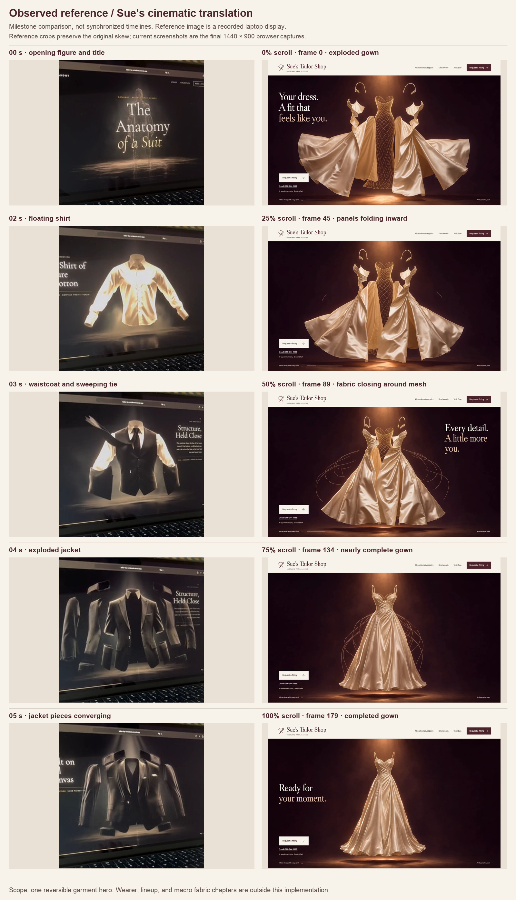

# Observed reference and current cinematic hero

Reviewed November 17, 2026, America/Chicago. This compares the observed garment choreography with the current single-hero implementation. It records the visible similarities, differences, and remaining framing limits; it does not claim identical timing, visual parity, or user acceptance.

## Evidence and freshness

- Reference: the user's [Instagram reel](https://www.instagram.com/reel/Da8LPoqoLY5/), retained in the [reference study](../assembly/reference-study.md), [full reel contact sheet](../assembly/reference-reel-contact-sheet.jpg), and [assembly detail](../assembly/reference-assembly-detail.jpg). The left column above uses the actual 0, 2, 3, 4, and 5-second tiles from the retained assembly detail. Each tile is cropped to its upper 288 × 288 pixels, then scaled without perspective correction. The laptop, skew, and cropped source copy remain part of the recording.
- Current desktop: `width-1440-forward-000.png`, `025.png`, `050.png`, `075.png`, and `100.png` in this directory. These are native-scroll browser captures at a 1440 × 900 viewport. File modification times are **2026-11-18 01:30:15.079–01:30:22.769 UTC**, after the final run's **2026-11-18T01:29:39.494Z** start recorded in [browser-results.json](browser-results.json). The final report status is passed; these captures include the resize-recovery fix. Thus this sheet uses the final 180-frame sequence, not the earlier 243-frame version or rejected cutout prototype.
- Current mobile: the corresponding `width-390-forward-*` captures were also inspected. They show the independently generated portrait film. The desktop and portrait source progressions are retained in the [landscape contact sheet](cinematic-motion-contact-sheet.jpg) and [portrait contact sheet](mobile/cinematic-motion-contact-sheet.jpg).
- The [landscape manifest](../../../../public/demos/best-tailor/media/cinematic/manifest.json) records 180 frames at 24 fps from the first 7.5 seconds of the generated unsewing shot, reversed for assembly. The [portrait manifest](../../../../public/demos/best-tailor/media/cinematic/mobile/manifest.json) records its separate source. These are illustrative generated films, not photographs of Sue's work or evidence of a physical cloth simulation.

## Deliberately different milestone timing

Reference seconds are positions in a phone recording of a person scrolling. Current percentages are fixed positions within the pinned browser scroll interval. Rows compare construction ideas; they are not time synchronization or a frame-for-frame match. Frame indices below are zero based and come from the current browser report.

| Current checkpoint | What the current desktop capture shows | Observed reference milestone | Material difference |
| --- | --- | --- | --- |
| **0% · frame 0 · scroll Y 0** | Broad ivory panels surround a visible central mesh form; straps float above it. The introductory heading sits left. | **0 seconds:** faint figure with a centered introductory title. | Sue's hero begins with the exploded garment already visible. It does not reproduce the reference's quieter figure reveal. |
| **25% · frame 45 · scroll Y 643** | Side panels curl inward while the mesh remains visible; the introductory copy has cleared. | **2 seconds:** a floating white shirt has formed. | The reference establishes a separate shirt layer. This version continues shaping one dress. |
| **50% · frame 89 · scroll Y 1286** | Bodice and skirt panels draw closer around the mesh, with fine strands around the sides. Editorial copy appears right. | **3 seconds:** waistcoat panels and a sweeping tie arrive over the shirt. | Both show a central garment developing beneath changing side copy; the actual clothing, motion paths, and construction are different. |
| **75% · frame 134 · scroll Y 1930** | The gown is nearly closed; strands remain visible around the skirt and the side copy has cleared. | **4 seconds:** jacket sleeves and other pieces occupy a clear exploded state. | Sue's gown is farther toward completion at this checkpoint. No equal pacing or identical exploded geometry is claimed. |
| **100% · frame 179 · scroll Y 2574** | A complete gown is visible from straps through hem, with the closing heading left. | **5 seconds:** jacket pieces are converging, with small lower fragments still separated. | The current endpoint is a finished gown. The reference continues into further chapters after the construction passage. |

The retained reference also shows upward scrolling returning through earlier construction states. Current reverse-scroll evidence and pixel comparisons are reported separately in [browser-results.json](browser-results.json); this static sheet cannot establish motion smoothness by itself.

## Composition and scope assessment

The translation preserves a central floating garment, warm overhead light, a dark stage, a floor glow, changing serif side copy, and a slim progress indicator. It changes the suit to an ivory gown and uses burgundy, cream, and warmer plum tones. Current landscape frames show cloth bending and closing within one coherent rendered scene, rather than independent flat cutouts. A fixed camera serves this one garment sequence.

The reference's worn suit, group of suited figures, and macro cuff/fabric chapters are outside this revision's single-hero scope. No wearer scene, lineup, macro-camera sequence, additional service promise, or custom garment-design claim is implied by this comparison.

Across all five inspected desktop checkpoints, the heading, appointment actions, and progress/caption remain legible. The completed gown's straps and hem fit inside the frame. At the opening, broad cloth approaches the lower-left contact area, but the opaque button remains readable and no text is covered by the subject.

The portrait film keeps the central construction and completed gown within the mobile frame. At **0%**, the outermost fabric sweep reaches and is slightly clipped by the left and right viewport edges; the final silhouette is fully visible. This is a remaining framing difference, not evidence that every opening cloth edge is preserved. At **25%** and **75%**, the reserved title band is empty between copy phases. The fixed fitting/call bar remains visually separate from the gown and footer caption in the inspected captures.

This comparison is limited to the captured hero states. Full-page regression, interaction results, and performance measurements belong to the separate final QA report.

Suggested commit message: `docs: compare cinematic tailor hero with observed reference`
